

# Cove Browser

### Fingerprint browser platform for cross-border e-commerce

Independent browser environments per storefront ！ fingerprint ， cookies ， proxy egress  
Reduce store linking and team account bleed

 

[English](./README.en.md) ， [嶄猟](./README.md)

 

&nbsp;

&nbsp;

  

**Download** ★ [covebrowser.com](https://covebrowser.com/)　��　Current **v0.1.14**

 

| Store isolation | Team collaboration | Batch efficiency |
|:---:|:---:|:---:|
| One store, one environment | Roles, assignment, shared workspace | Window sync + local API / CDP |

---

## Contents

- [Platform](#platform)
- [Detection results](#detection-results)
- [Use cases](#use-cases)
- [Get started](#get-started)
- [Contact](#contact)

---

## Platform

Cove Browser is a desktop fingerprint-browser **platform** for **sellers, agencies, and business teams**.  
For Amazon, Shopify, Shopee, TikTok Shop and more, each storefront becomes an isolated runtime ！ fingerprint, cookies, storage, and proxy egress stay separate ！ with account warm-up, window sync, and local automation.

  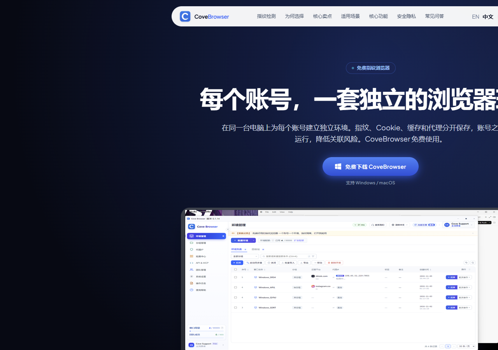

### Platform capabilities

| | Capability | Notes |
|:---:|---|---|
| 01 | **Multi-account environments** | Isolated fingerprint, cookies, storage, proxy |
| 02 | **Batch ops** | Create, import, start, stop, recycle bin |
| 03 | **Groups & tags** | Organize by project / client / owner |
| 04 | **Window sync** | Mouse, keyboard, scroll across windows |
| 05 | **Local API** | Localhost JSON API; CDP after launch |
| 06 | **Team collaboration** | Members, roles, permissions, assignment |
| 07 | **Proxy management** | HTTP / HTTPS / SOCKS5 with checks |

### Client UI

  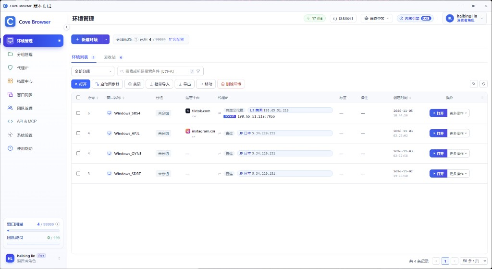

Environment manager ！ stores, fingerprints, proxies, groups, notes

 

  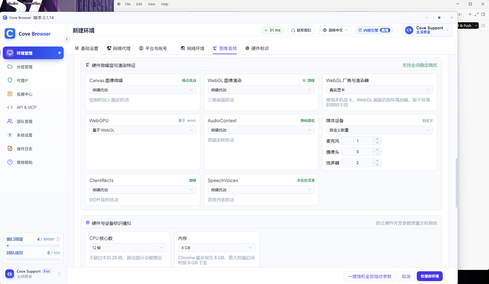

Fingerprint settings ！ Canvas / WebGL / Audio / hardware isolated per profile

 

  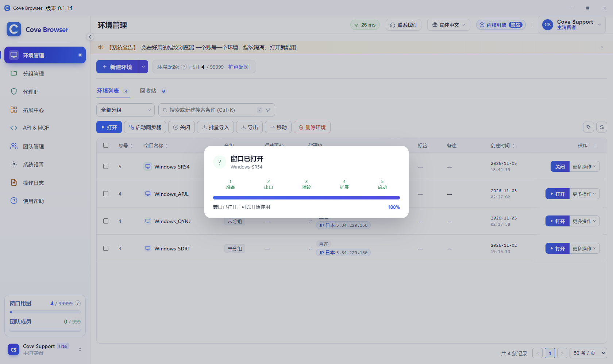

Launch ！ open an independent browser window when ready

---

## Detection results

Profiles present as **Chrome** (UA / Client Hints). Public third-party samples ！ retest yourself.

| Detector | Focus | Result |
|---|---|:---:|
| [Fingerprint.com](https://demo.fingerprint.com/) | Bot / VPN / tampering / VM | **Not detected** |
| [BrowserScan](https://www.browserscan.net/) | Identity, timezone, language, WebRTC | **Top-tier authenticity** |
| [bot.sannysoft.com](https://bot.sannysoft.com/) | WebDriver, Chrome, plugins, WebGL | **Passed** |
| [ScrapingCourse Antibot](https://www.scrapingcourse.com/antibot-challenge) | Antibot challenge | **Bypassed** |
| [DeviceAndBrowserInfo](https://deviceandbrowserinfo.com/) | isBot / WebDriver / Headless | **You are human** |

<b>Show detection screenshots</b>

 

  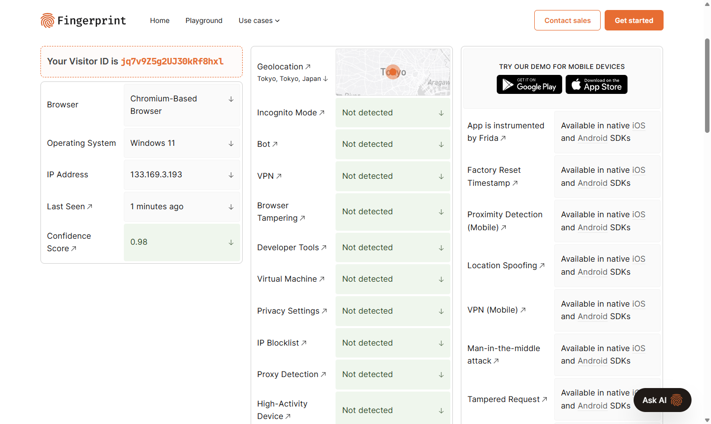

Fingerprint.com ！ Bot / Tampering / VM not detected

 

  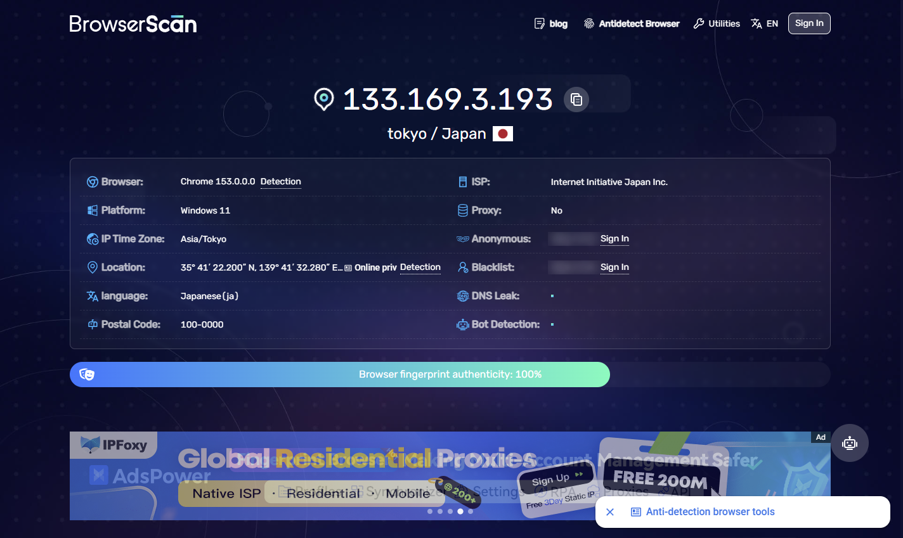

BrowserScan ！ fingerprint authenticity at top tier

 

  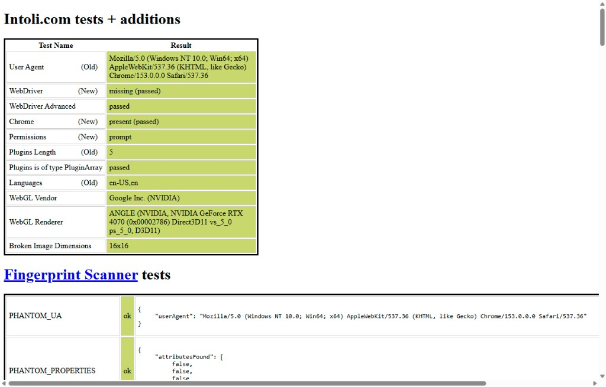

bot.sannysoft.com ！ WebDriver missing and related checks

 

  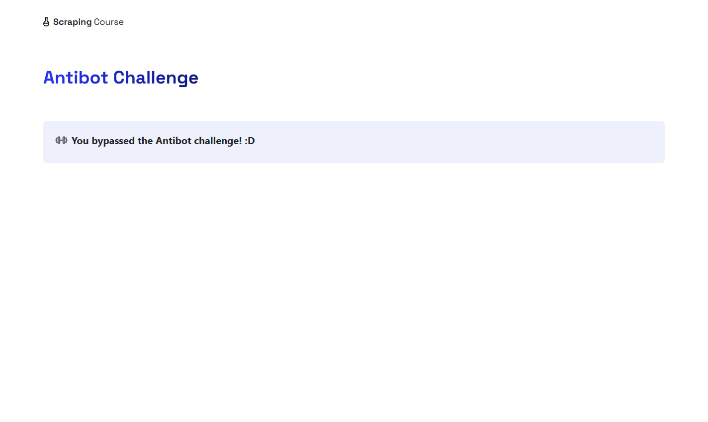

ScrapingCourse Antibot Challenge ！ bypassed

 

  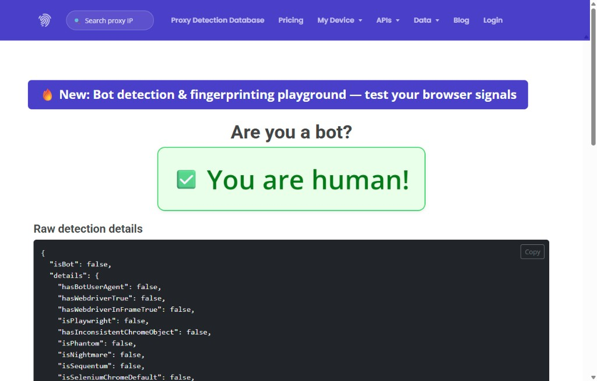

DeviceAndBrowserInfo ！ You are human

> Results vary by detector and setup. Retest with a region-matched proxy before go-live.

---

## Use cases

Sellers and business teams worry about **linked stores** and **shared browsers causing account bleed**.  
Cove Browser turns every store or account into an isolated environment ！ fingerprint, cookies, storage, and proxy egress stay separate.

  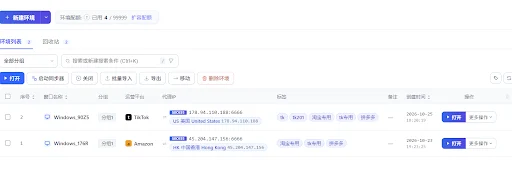
  &nbsp;&nbsp;
  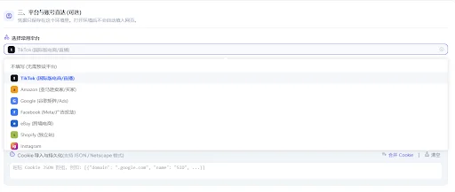

| Scenario | How teams use it |
|---|---|
| **Multi-marketplace ops** | Amazon, Shopify, eBay, Shopee, Lazada, Walmart, TikTok Shop ！ one store, one environment + regional proxy |
| **Registration & warm-up** | Keep fingerprint and egress IP consistent through signup, review, and growth |
| **Ads & reporting** | Separate Meta / Google / on-platform ad accounts; window sync for budgets and reports |
| **Social & private-domain** | Isolate Facebook, Instagram, TikTok, YouTube, WhatsApp for parallel publishing and DMs |
| **Agencies & business teams** | Group by client 〜 store with roles; hand off without rebuilding fingerprints and proxies |
| **Local automation** | Local API inside an environment; CDP after launch for repricing, scraping, listing |

---

## Get started

| Step | Action |
|:---:|---|
| 1 | Download the client from [covebrowser.com](https://covebrowser.com/) (Windows / macOS) |
| 2 | Sign in with email (personal or team) |
| 3 | Create an environment (fingerprint, proxy, notes) |
| 4 | Launch; enable the local API when you need automation |

 

**Get started** ★ [Download Cove Browser](https://covebrowser.com/)

---

## Contact

| | |
|---|---|
| Website | [covebrowser.com](https://covebrowser.com/) |
| Email | [support@covebrowser.com](mailto:support@covebrowser.com) |
| Telegram | [@covebrowser](https://t.me/covebrowser) |
| Issues | [covebrowser-bit/CoveBrowser](https://github.com/covebrowser-bit/CoveBrowser/issues) |

---

## Star History

---

MIT License ， Installers from the website

