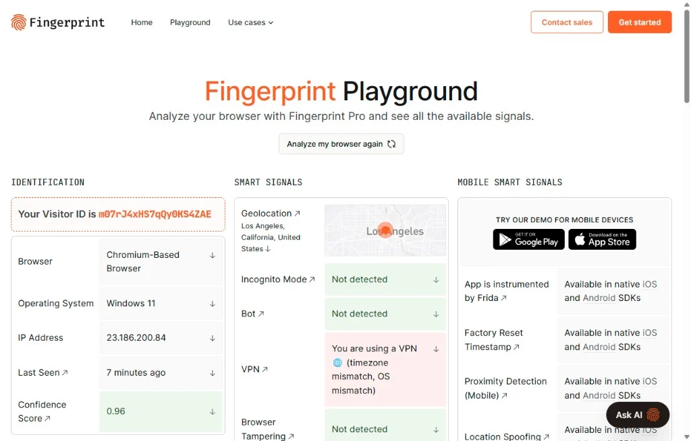
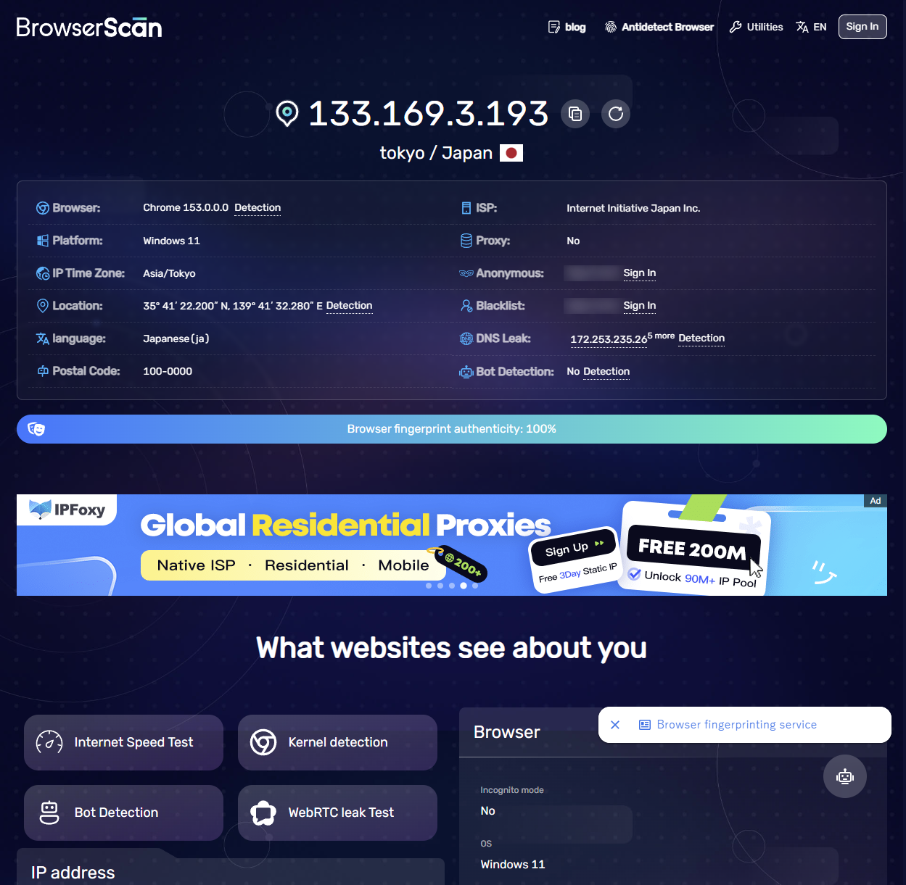

# Cove Browser

**Enterprise fingerprint browser ¡ª desktop client**

[English](./README.en.md) ¡¤ [ÖÐÎÄ](./README.md)

A desktop client for everyday users and teams: create environments, bind proxies, manage members, and sync windows ¡ª without hand-crafting CLI flags.

- Download: [covebrowser.com](https://covebrowser.com/) (Windows ¡¤ macOS)
- Current client: **Cove Browser v0.1.14**

---

## Contents

- [Website](#website)
- [Screenshots](#screenshots)
- [Features](#features)
- [Detection samples](#detection-samples)
- [Get started](#get-started)
- [About this repo](#about-this-repo)
- [Contact](#contact)
- [Star History](#star-history)

---

## Website

[covebrowser.com](https://covebrowser.com/) introduces isolated environments, fingerprint controls, proxies, window sync, and team collaboration, and hosts installers.

  

<em>Marketing site + environment manager preview</em>

---

## Screenshots

### Environment manager

Independent profiles for fingerprint, proxy, groups, and notes.

  

### Fingerprint settings

Configure Canvas / WebGL / Audio / hardware and OS parameters per profile.

  

### Launch progress

Startup progress while the kernel and proxy become ready.

  

### Scenarios

Multi-store and social matrices with isolated cookies, fingerprints, and egress.

  
  &nbsp;
  

---

## Features

| Feature | Notes |
|---|---|
| Multi-account environments | Isolated fingerprint, cookies, storage, proxy |
| Batch ops | Create, import, start, stop, recycle bin |
| Groups & tags | Organize by project / client / owner |
| Window sync | Mirror mouse, keyboard, and scroll |
| Local API | Localhost JSON API; returns CDP after launch |
| Team collaboration | Members, roles, permissions |
| Proxies | HTTP / HTTPS / SOCKS5 with connectivity checks |

Profiles present as **Chrome** (UA / Client Hints) on detection sites.

---

## Detection samples

  

  

---

## Get started

1. Download from [covebrowser.com](https://covebrowser.com/)  
2. Sign in with email  
3. Create an environment  
4. Launch; enable the local API when you need automation  

---

## About this repo

| | This repository |
|---|---|
| Includes | README, license, feature docs & screenshots |
| Does not include | Electron source, Chromium fingerprint kernel, backend, secrets |
| Installers | Distributed from the website, not as source in this repo |

---

## Contact

- Website: [covebrowser.com](https://covebrowser.com/)
- Email: [support@covebrowser.com](mailto:support@covebrowser.com)
- Telegram: [@covebrowser](https://t.me/covebrowser)
- Issues: [covebrowser-bit/CoveBrowser](https://github.com/covebrowser-bit/CoveBrowser/issues)

---

## Star History

