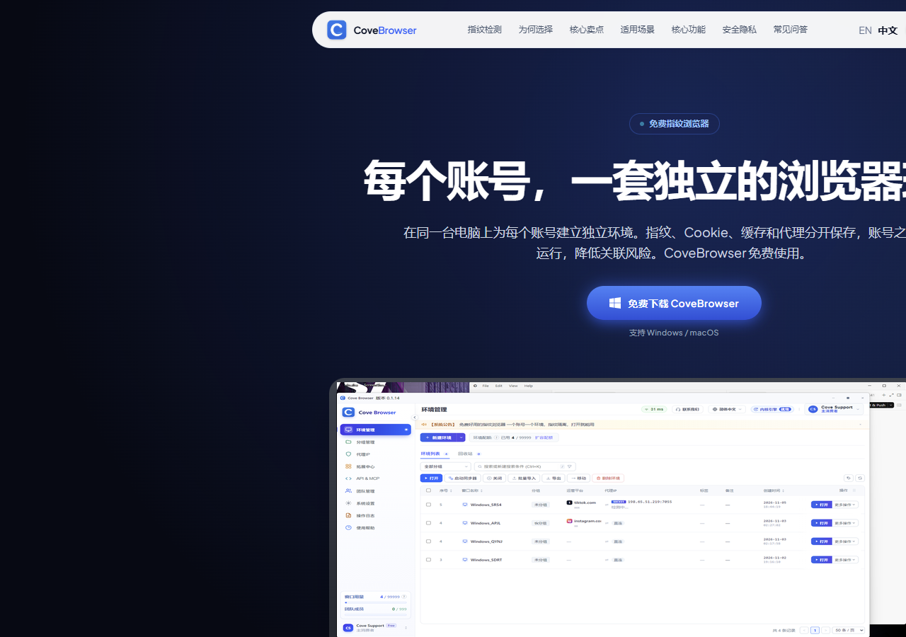
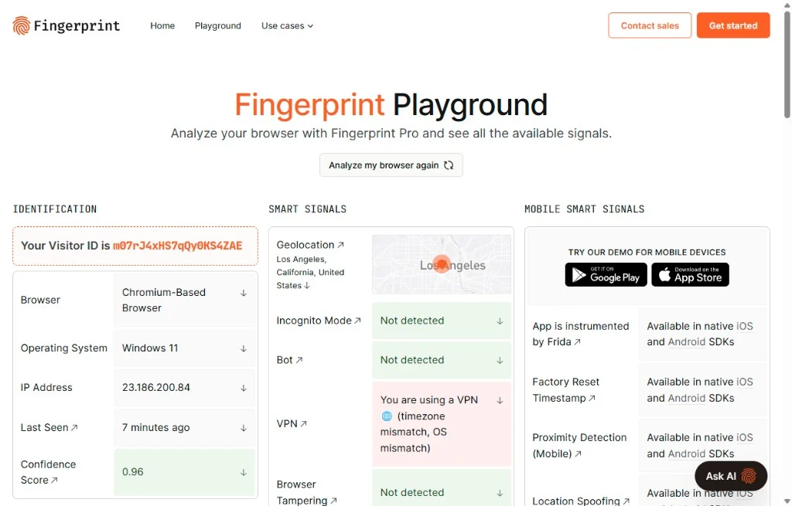
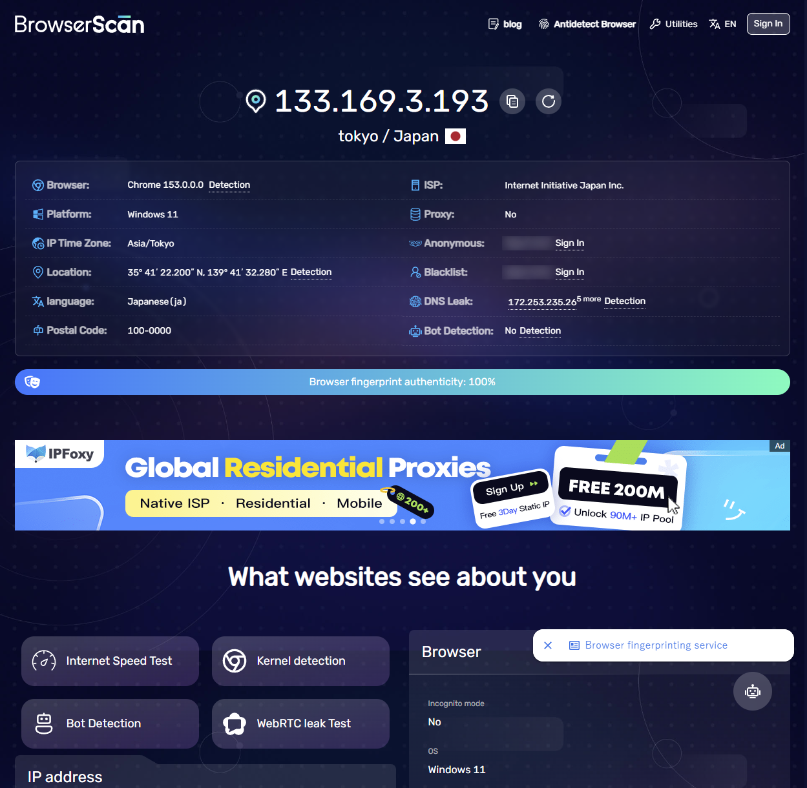
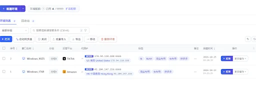
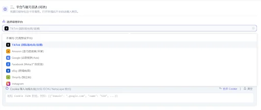
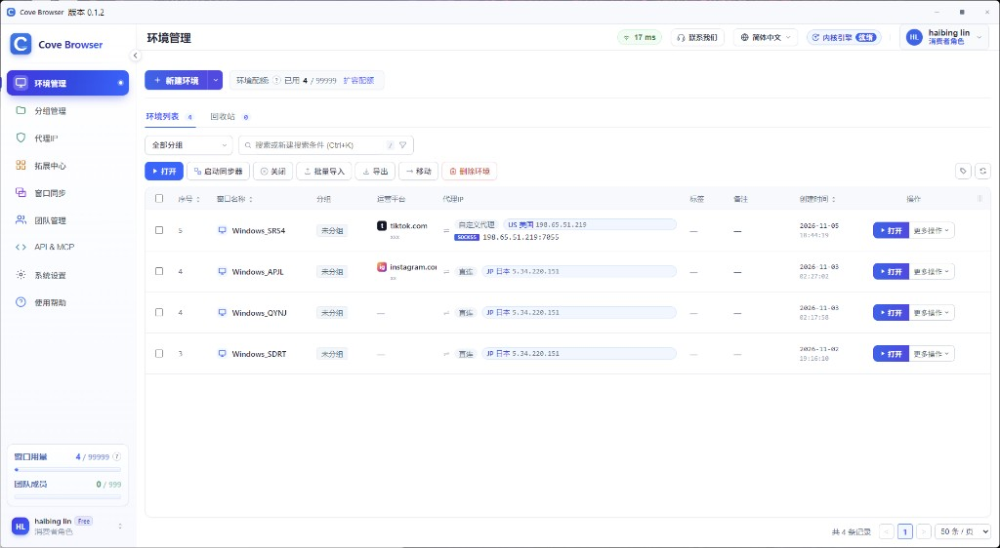
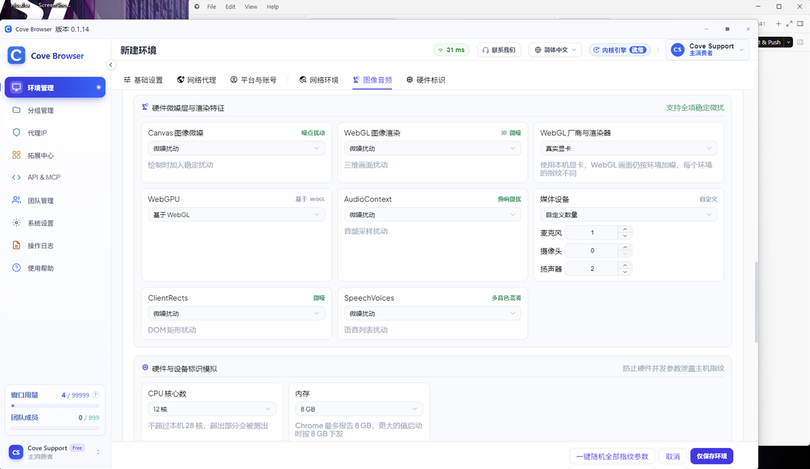
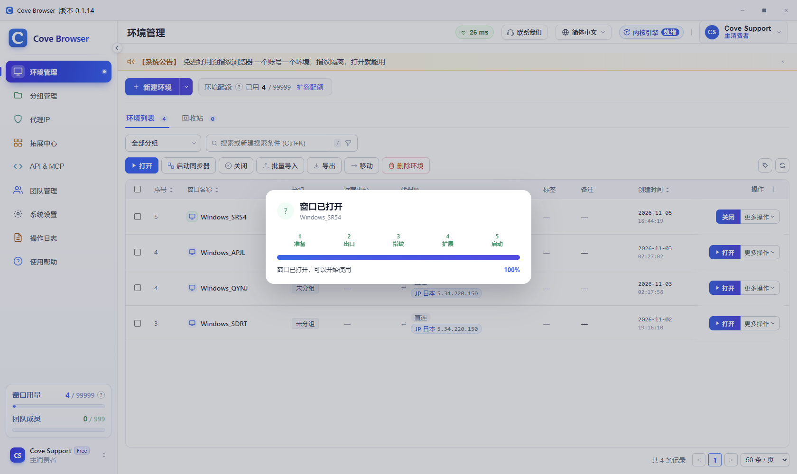

# Cove Browser

**面向跨境电商的指纹浏览器桌面客户端**

[English](./README.en.md) ・ [中文](./README.md)

给跨境电商卖家和运营团队用――多店铺、多站点各自独立环境，配好代理就能开店养号、窗口同步批量操作，不用自己拼命令行。

- 官网下载：[covebrowser.com](https://covebrowser.com/)（Windows ・ macOS）
- 当前客户端：**Cove Browser v0.1.14**

---

## 目录

- [官网](#官网)
- [权威检测结果](#权威检测结果)
- [应用场景](#应用场景)
- [功能说明](#功能说明)
- [软件截图](#软件截图)
- [四步上手](#四步上手)
- [仓库说明](#仓库说明)
- [联系我们](#联系我们)
- [Star History](#star-history)

---

## 官网

[covebrowser.com](https://covebrowser.com/) 是产品主页：介绍独立环境、指纹隔离、代理绑定、窗口同步与团队协作，并提供安装包下载。

  

<em>官网首页：产品介绍 + 客户端环境管理界面</em>

---

## 权威检测结果

内核侧按 **Chrome** 身份呈现（UA / Client Hints）。以下为公开第三方检测站实测示例，可自行打开对应站点复测核对，用结果证明环境质量，而不是口头承诺。

| 检测站 | 关注点 | 说明 |
|---|---|---|
| Fingerprint.com / 同类指纹站 | Canvas、WebGL、Audio、硬件一致性 | 环境内指纹稳定、可复现 |
| BrowserScan 等综合检测 | 浏览器身份、时区、语言、WebRTC 等 | 按常规 Chrome 画像评分，而非未知浏览器 |
| 平台风控相关页面 | 登录态与设备画像 | 结合代理地区配置后用于开店、养号前自检 |

  

<em>Fingerprint 类检测示例：设备与浏览器指纹表现</em>

  

<em>BrowserScan 等综合检测示例：按 Chrome 身份呈现</em>

> 检测结果会随站点算法与本机配置变化；正式开店前建议用目标站点地区代理 + 对应环境再测一轮。

---

## 应用场景

跨境卖家日常最怕两件事：**店铺互相牵连**，以及**团队共用一台电脑/一个浏览器导致账号串号**。Cove Browser 把「每个店铺 / 每个账号」做成独立环境――指纹、Cookie、本地存储、代理出口分开，适合从个人卖家到代运营团队的规模化经营。

  
  &nbsp;
  

### 多平台多店铺运营

Amazon、Shopify、eBay、Shopee、Lazada、Walmart、TikTok Shop 等平台，一个卖家往往同时管理几十上百个店铺。把每个店铺绑定独立环境 + 对应地区代理，后台登录、上架改价、订单履约互不干扰，降低「一号异常、全店受影响」的连锁风险。

### 新店注册与养号

开店、过审、养权重需要稳定的设备与网络画像。为注册、登录、日常浏览分别规划环境，让每个账号长期保持一致的指纹与出口 IP，减少频繁换机、换浏览器带来的异常波动，更适合批量建店与长期维护。

### 广告投放与数据看板

一个团队常同时跑多套广告账户（Meta、Google、平台站内广告等）。用独立环境打开各自后台，配合窗口同步可对多账户做同类操作（改预算、查报表、批量开关活动），减少来回切号、清缓存的时间成本。

### 社媒与私域矩阵

跨境获客离不开 Facebook、Instagram、TikTok、YouTube、WhatsApp、邮件营销工具等矩阵账号。每个账号独立环境后，内容发布、私信回复、社群运营可以并行推进，避免 Cookie 串号导致账号关联。

### 代运营 / 工作室协作

服务多家客户时，按「客户 × 店铺」分组管理环境，给成员分配可见范围与操作权限。负责人只需维护一套环境库，新人接手不用重新配指纹和代理，交付更标准、权限更清晰。

### 本地自动化与批量任务

需要脚本批量改价、采集、上架时，可开启本机 API，在指定环境内对接自动化流程；打开环境后可拿到 CDP 地址，把「隔离环境」和「效率工具」接在同一条链路上。

---

## 功能说明

把检测站验过的隔离能力，落到日常开店与团队协作里：

| 功能 | 说明 |
|---|---|
| 多账号环境 | 每个环境独立指纹、Cookie、存储和代理 |
| 批量管理 | 创建、导入、启动、停止、回收站 |
| 分组与标签 | 按项目、客户或负责人整理环境 |
| 窗口同步 | 主控窗口的鼠标、键盘、滚动同步到多个从窗口 |
| 本地 API | 本机 JSON API，可对接自动化；打开环境后返回 CDP |
| 团队协作 | 成员、角色、权限、环境分配 |
| 代理 | HTTP / HTTPS / SOCKS5 等，保存、检测、绑定到环境 |

---

## 软件截图

下面是桌面客户端主要功能界面（v0.1.x）。

### 环境管理

给每个账号建独立环境：指纹、代理、分组、备注分开存放。启动、编辑、分享、删除都在这一页。

  

### 指纹配置

按环境配置 Canvas / WebGL / Audio / 硬件与系统参数，账号之间不共用一套设备特征。

  

### 启动环境

打开环境时显示启动进度；内核与代理就绪后进入独立浏览器窗口。

  

---

## 四步上手

1. 打开 [covebrowser.com](https://covebrowser.com/) 下载客户端  
2. 用邮箱登录（个人或团队都可以）  
3. 创建环境：指纹、代理、备注  
4. 打开环境开始工作；需要自动化再开本地 API  

---

## 仓库说明

| | 本仓库 |
|---|---|
| 内容 | README、许可证、功能说明与截图 |
| 不包含 | Electron 源码、Chromium 指纹内核、服务端与密钥 |
| 安装包 | 请从官网下载，不以源码形式随仓库分发 |

---

## 联系我们

- 官网：[covebrowser.com](https://covebrowser.com/)
- 邮箱：[support@covebrowser.com](mailto:support@covebrowser.com)
- Telegram：[@covebrowser](https://t.me/covebrowser)
- QQ 群：`263172684`
- Issues：[covebrowser-bit/CoveBrowser](https://github.com/covebrowser-bit/CoveBrowser/issues)

---

## Star History

